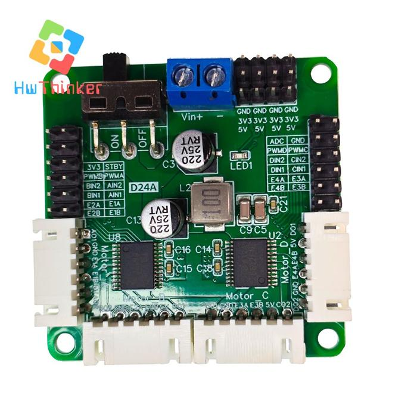
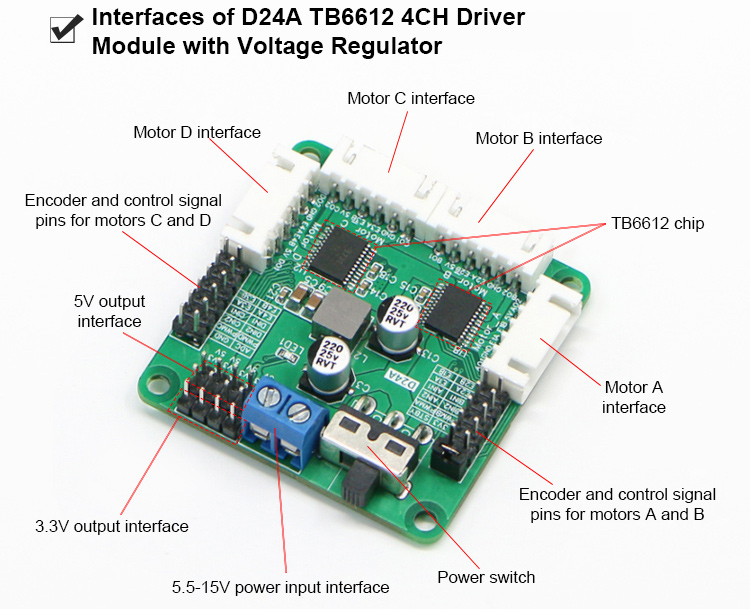
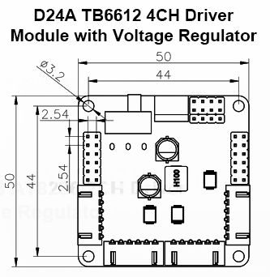
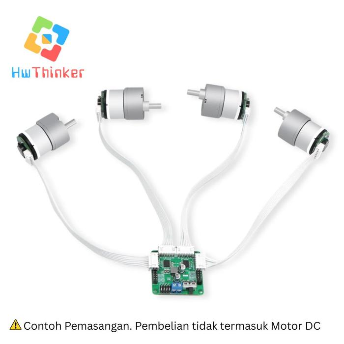

# D24A – 4-Channel TB6612 Motor Driver (WHEELTEC) + Arduino Mega









Spesifikasi

- Tegangan Motor (VM): Hingga 15V DC
- Tegangan Logika (VCC): 2.7 – 5.5V
- Arus Keluaran: 1.2A rata-rata / 3.2A puncak per channel
- Frekuensi PWM: Hingga 100kHz
- Mode Kontrol: CW (searah jarum jam), CCW (berlawanan arah jarum jam), short-brake, dan stop
- Fitur Tambahan: Proteksi arus berlebih, suplai daya stabil, dan dukungan untuk motor DC dengan encoder


Contoh penggunaan modul **D24A** (WHEELTEC) untuk mengendalikan **4 motor DC ber-encoder**: kontrol arah dan kecepatan, pembacaan encoder, dan monitoring tegangan baterai.

Tersedia dua versi sketch:

| File | Board | Encoder |
|------|-------|---------|
| `D24A_Mega_Test.ino`  | Arduino Mega 2560 | x2, interrupt (ISR) |
| `D24A_ESP32_Test.ino` | ESP32 DevKit (ESP32 klasik) | x4, hardware PCNT |

> [!CAUTION]
> **PENGGUNA ESP32: JANGAN LANGSUNG COLOK ENCODER KE ESP32.**
>
> Konektor motor di D24A mencatu encoder dengan **5V**, sehingga sinyal E1A–E4B kemungkinan besar berayun **0–5V**. GPIO ESP32 **TIDAK toleran 5V** (batas aman 3.3V, absolute max ≈ 3.6V). Tegangan berlebih bisa:
>
> - **Merusak permanen** pin GPIO atau seluruh chip ESP32, kadang tidak langsung tapi pelan-pelan (degradasi)
> - Mengacaukan pembacaan encoder tanpa tanda kerusakan yang jelas
> - Membuat board **gagal boot / gagal upload** kalau sinyal masuk ke pin strapping
>
> **Wajib:** ukur dulu level sinyal encoder, lalu pasang **level shifter atau pembagi resistor** di 8 jalur encoder sebelum menghubungkan ke ESP32. Detail di **[Bagian 6.3](#63-️-level-tegangan-encoder)**. Kerusakan akibat mengabaikan peringatan ini menjadi tanggung jawab pengguna.

---

## 1. Tentang Modul

D24A berisi **2 chip TB6612FNG**, sehingga bisa menggerakkan 4 motor DC brushed sekaligus:

| Chip | Channel |
|------|---------|
| U8   | Motor A, Motor B |
| U2   | Motor C, Motor D |

Fitur utama:

- Regulator onboard, jadi tidak perlu catu logika eksternal
- Output daya **5V** dan **3V3** yang terproteksi (header atas, 4 titik masing-masing)
- Pin **ADC** untuk monitor baterai (pembagi 10kΩ + 1kΩ → **Vin / 11**)
- 4 konektor motor encoder standar **XH2.54 6P**
- Saklar power ON/OFF dan proteksi suhu
- Kompatibel dengan motor TT, MG310, MG370, MG513

> Batas TB6612FNG: **1.2A kontinu / 3.2A peak per channel**, VM maks 15V.

---

## 2. Pinout

### 2.1 Header kontrol kiri (Motor A & B)

| Kiri  | Kanan |
|-------|-------|
| 3V3   | STBY  |
| PWMB  | PWMA  |
| BIN2  | AIN2  |
| BIN1  | AIN1  |
| E2A   | E1A   |
| E2B   | E1B   |

### 2.2 Header kontrol kanan (Motor C & D)

| Kiri  | Kanan |
|-------|-------|
| ADC   | GND   |
| PWMD  | PWMC  |
| DIN2  | CIN2  |
| DIN1  | CIN1  |
| E4A   | E3A   |
| E4B   | E3B   |

### 2.3 Header power atas (4 kolom)

```
GND  GND  GND  GND
3V3  3V3  3V3  3V3
5V   5V   5V   5V
```

### 2.4 Input baterai

Terminal biru **Vin+ / −**, dilewatkan ke saklar ON/OFF.

### 2.5 Konektor motor 6P (XH2.54)

| Motor | 1   | 2   | 3   | 4   | 5  | 6   |
|-------|-----|-----|-----|-----|----|-----|
| A     | AO1 | GND | E1A | E1B | 5V | AO2 |
| B     | BO2 | GND | E2A | E2B | 5V | BO1 |
| C     | CO1 | GND | E3A | E3B | 5V | CO2 |
| D     | DO2 | GND | E4A | E4B | 5V | DO1 |

> ⚠️ Urutan output **B dan D terbalik** (xO2 di pin 1) dibanding A dan C. Dengan perintah yang sama, motor B/D berputar berlawanan arah. Ini dikoreksi di kode lewat `MOTOR_DIR[]`.

---

## 3. Logika Kontrol TB6612

| xIN1 | xIN2 | PWMx | Hasil |
|------|------|------|-------|
| H    | L    | PWM  | Maju (kecepatan ~ duty) |
| L    | H    | PWM  | Mundur |
| L    | L    | X    | Coast (motor lepas) |
| H    | H    | X    | Short brake |
| X    | X    | X    | **STBY = LOW → semua motor mati** |

- **STBY harus HIGH** supaya driver aktif. Bisa dihubungkan ke pin MCU, atau di-jumper ke **3V3** yang sebaris di header kiri.
- Motor hanya berputar kalau PWM aktif. IN1/IN2 saja tidak cukup.
- TB6612 mendukung PWM sampai 100 kHz. Sketch ini memakai **~31 kHz** supaya motor tidak mendengung.

---

## 4. Wiring ke Arduino Mega 2560

| D24A       | Mega          | Keterangan |
|------------|---------------|------------|
| PWMA       | D6  (OC4A)    | PWM motor A |
| AIN1/AIN2  | D30 / D31     | Arah A |
| PWMB       | D7  (OC4B)    | PWM motor B |
| BIN1/BIN2  | D32 / D33     | Arah B |
| PWMC       | D8  (OC4C)    | PWM motor C |
| CIN1/CIN2  | D34 / D35     | Arah C |
| PWMD       | D44 (OC5C)    | PWM motor D |
| DIN1/DIN2  | D36 / D37     | Arah D |
| STBY       | D38           | HIGH = aktif |
| E1A..E4A   | D2, D3, D18, D19 | Pin interrupt |
| E1B..E4B   | D22, D23, D24, D25 | Input digital |
| ADC        | A0            | Vbat / 11 |
| GND        | GND           | **Wajib common ground** |

Catatan:

- Header kiri **tidak punya pin GND**. Ambil ground dari header kanan atau header power atas.
- Mega dipakai karena 4 encoder butuh 4 pin interrupt (Uno hanya punya 2).
- D20/D21 (I2C) sengaja tidak dipakai, supaya bisa untuk IMU/OLED.
- Encoder dicatu **5V** dari board. Untuk MCU 3.3V (ESP32, STM32, RP2040), cek dulu level sinyal E-nya sebelum dihubungkan langsung.
- Logika TB6612 kemungkinan dicatu 3V3 onboard. Input 5V dari Mega masih dalam batas absolut input chip (≈6V).

---

## 5. Sketch: `D24A_Mega_Test.ino`

### Fungsi utama

```cpp
void setMotor(uint8_t i, int speed); // i: 0..3 (A..D), speed: -255..255, 0 = coast
void brakeMotor(uint8_t i);          // short brake
void setAll(int a, int b, int c, int d);
long readEnc(uint8_t i);             // count encoder (atomic read)
float readVbat();                    // tegangan baterai (V)
```

### Konfigurasi

```cpp
const int8_t ENC_DIR[4]   = {1, 1, 1, 1};   // balik tanda hitungan encoder
const int8_t MOTOR_DIR[4] = {1, -1, 1, -1}; // koreksi arah B & D
```

### PWM ~31 kHz

Prescaler Timer4 dan Timer5 diubah ke 1 (mode phase-correct 8-bit: 16 MHz / 510 ≈ 31.4 kHz):

```cpp
TCCR4B = (TCCR4B & 0xF8) | 0x01;   // D6, D7, D8
TCCR5B = (TCCR5B & 0xF8) | 0x01;   // D44, D45, D46
```

`analogWrite()` tetap bekerja dengan rentang 0–255. Timer0 tidak diubah, jadi `millis()` dan `delay()` tetap normal.

### Encoder

Decoding x2: interrupt `CHANGE` di fasa A, lalu arah ditentukan dari perbandingan A dan B.

```
A == B → +1    A != B → −1   (dikali ENC_DIR)
```

### Demo

Setiap 2 detik semua motor menjalankan urutan:
`80 → 180 → 0 (coast) → −120 → brake`

Serial Monitor (**115200 baud**) mencetak count dan delta per 100 ms tiap motor, ditambah tegangan baterai:

```
MA: 1520 (64)  MB: 1498 (62)  MC: 1533 (65)  MD: 1510 (63)  Vbat=11.84V
```

---

## 6. Versi ESP32: `D24A_ESP32_Test.ino`

> [!WARNING]
> **Checklist wajib sebelum menyambungkan D24A ke ESP32:**
>
> - [ ] Sudah **mengukur** level sinyal encoder (E1A–E4B) dengan multimeter atau osiloskop
> - [ ] Kalau ~5V: sudah memasang **level shifter / pembagi resistor** di **ke-8 jalur** encoder
> - [ ] **Tidak ada** pin 5V dari D24A (header power atau pin 5 konektor 6P) yang tersambung ke GPIO ESP32
> - [ ] Tidak memakai **GPIO0, GPIO12, GPIO6–11** untuk sinyal dari D24A
> - [ ] **GND** D24A dan ESP32 sudah tersambung (common ground)
> - [ ] Kalau ESP32 dicatu dari header 5V D24A, sambungkan ke pin **5V/VIN** ESP32, **bukan ke 3V3**
> - [ ] **Jangan** mencatu ESP32 dari USB dan dari 5V D24A bersamaan, kecuali board ESP32 kamu punya dioda proteksi di jalur VIN
>
> Kalau salah satu belum dicentang, **jangan nyalakan dulu**.

### 6.1 Kebutuhan pin

| Fungsi | Jumlah |
|--------|--------|
| PWM (A–D) | 4 |
| IN1/IN2 (A–D) | 8 |
| Encoder A/B (E1–E4) | 8 |
| STBY | 1 |
| ADC Vbat | 1 |
| **Total** | **22** |

ESP32 klasik punya sekitar 21 GPIO yang aman, ditambah beberapa pin strapping. Jadi 22 pin masih cukup, tapi **I2C tidak kebagian**. Kalau butuh I2C (IMU/OLED), ada dua cara menghemat pin:

- Jumper **STBY ke 3V3** di header kiri (hemat 1 pin). Pin PWM dan IN yang dipakai di sini tidak glitch saat boot, jadi tetap aman.
- Tidak memakai pin **ADC** (hemat 1 pin).

Kalau tersedia **ESP32-S3**, itu alternatif yang lebih lega. GPIO-nya lebih banyak sehingga I2C tetap bisa dipakai, dan PCNT-nya 4 unit, pas untuk 4 encoder.

### 6.2 Wiring ke ESP32 DevKit

| D24A | GPIO | Catatan |
|------|------|---------|
| STBY | 4 | LOW saat boot, motor aman tidak kedut |
| PWMA / PWMB / PWMC / PWMD | 25 / 26 / 27 / 13 | Pin tenang saat boot |
| AIN1 / AIN2 | 16 / 17 | |
| BIN1 / BIN2 | 18 / 19 | |
| CIN1 / CIN2 | 21 / 22 | |
| DIN1 / DIN2 | 23 / 2 | GPIO2 = LED onboard, aman sebagai output |
| E1A / E1B | 34 / 35 | Input-only, tanpa pull-up internal |
| E2A / E2B | 36 / 39 | Input-only, tanpa pull-up internal |
| E3A / E3B | 32 / 5 | |
| E4A / E4B | 14 / 15 | |
| ADC | 33 | Harus ADC1, karena ADC2 bentrok dengan WiFi |
| GND | GND | **Wajib common ground** |

Pin yang sengaja dihindari:

- **GPIO12**: kalau HIGH saat boot (misalnya ditarik encoder), flash di-set ke 1.8V dan board gagal boot.
- **GPIO0**: dipakai untuk mode download.
- **GPIO1/3**: UART0 (Serial / upload).
- **GPIO6–11**: terhubung ke flash internal.

### 6.3 ⚠️ Level tegangan encoder

> [!CAUTION]
> GPIO ESP32 **tidak toleran 5V**. Menyambungkan sinyal 5V langsung ke GPIO bisa merusak ESP32 secara permanen. Pin input-only (GPIO34–39) juga **tidak** lebih kebal; semuanya sama-sama 3.3V.

Konektor 6P di D24A mencatu encoder dengan **5V**. Encoder WHEELTEC punya pull-up internal, jadi kemungkinan besar sinyal E-nya HIGH di **5V**. Itu **melebihi batas GPIO ESP32 (3.3V)**.

Jangan tergoda trik "kan cuma sebentar" atau "pakai resistor seri 1k saja". Resistor seri saja tidak menurunkan level; arus tetap masuk lewat dioda proteksi internal dan menaikkan rail 3.3V ESP32.

Sebelum disambung:

1. Ukur tegangan pin E1A ke GND dengan multimeter sambil roda diputar pelan.
2. Kalau hasilnya sekitar 5V, wajib pasang penurun level di **8 jalur encoder**.

**Opsi A: pembagi resistor (per jalur)**

```
E_xA/B (5V) ──[ 10k ]──┬──── GPIO ESP32
                       │
                     [ 20k ]
                       │
                      GND
```

Hasilnya 5V × 20k / 30k ≈ 3.33V. Cukup untuk frekuensi encoder motor (orde kHz).

**Opsi B: IC buffer**, misalnya **74LVC245** atau **74LVC125** yang dicatu 3.3V. Input IC ini toleran 5V, jadi lebih rapi dan cepat untuk 8 jalur. Modul TXS0108 kurang cocok untuk sinyal dari pull-up encoder.

Jalur lain **aman tanpa level shifter**:

- PWM / IN / STBY: arahnya dari ESP32 (3.3V) ke TB6612, dan 3.3V sudah valid HIGH.
- ADC: 12V / 11 ≈ 1.1V, masih dalam rentang ADC.

### 6.4 Perbedaan dengan versi Mega

| Aspek | Mega | ESP32 |
|-------|------|-------|
| PWM | Timer4/5 prescaler 1 → ~31 kHz | LEDC `ledcAttach()` → 20 kHz, 8-bit |
| Encoder | ISR `CHANGE` di fasa A → **x2** | Hardware **PCNT** `attachFullQuad()` → **x4**, tanpa ISR |
| Filter encoder | – | `setFilter(250)` (~3 µs) untuk buang glitch |
| ADC | `analogRead()` × 5.0/1023 × 11 | `analogReadMilliVolts()` × 11 (kalibrasi eFuse) |
| Startup | STBY HIGH setelah setup | STBY ditahan **LOW** sampai semua pin siap |

> Count encoder di versi ESP32 **2× lebih besar** daripada versi Mega (x4 vs x2). Perhitungkan ini saat menghitung RPM:
>
> `RPM = (delta_count / (PPR × 4 × rasio_gear)) × (60000 / periode_ms)`

### 6.5 Kebutuhan software

- **Arduino-ESP32 core 3.x**. API `ledcAttach()` / `ledcWrite(pin, duty)` berbeda dengan core 2.x yang memakai `ledcSetup` + `ledcAttachPin`.
- Library **ESP32Encoder** (madhephaestus), install via Library Manager.

Fungsi API sketch sama dengan versi Mega: `setMotor()`, `brakeMotor()`, `setAll()`, `readEnc()`, `readVbat()`, plus konfigurasi `MOTOR_DIR[]` dan `ENC_DIR[]`.

---

## 7. Langkah Uji Pertama

1. Angkat robot sampai **roda tidak menyentuh lantai**.
2. Sambungkan baterai ke Vin, saklar masih **OFF**.
3. Hubungkan wiring sesuai tabel, pastikan GND bersama.
4. **(ESP32)** Ukur dulu level sinyal encoder, lalu pasang level shifter kalau ~5V (lihat 6.3).
5. Upload sketch, buka Serial Monitor 115200.
6. Nyalakan saklar **ON**.
7. Cek tiap motor:
   - Arah putar salah → ubah `MOTOR_DIR[i]`
   - Count turun saat motor maju → ubah `ENC_DIR[i]`
8. Pastikan pembacaan `Vbat` sesuai multimeter. Kalau meleset, kalibrasi faktor `11.0` (atau Vref `5.0` di versi Mega).

---

## 8. Troubleshooting

| Gejala | Kemungkinan penyebab |
|--------|----------------------|
| Semua motor diam | STBY tidak HIGH, saklar OFF, atau GND tidak common |
| Satu motor diam | PWM pin salah, kabel 6P longgar |
| Motor berdengung | PWM masih 490 Hz, cek setting `TCCRnB` |
| Count encoder 0 | Kabel E-A/E-B tertukar ke pin non-interrupt, encoder tidak dapat 5V |
| Count acak/loncat | Noise. Pendekkan kabel, pastikan GND bagus |
| Vbat tidak masuk akal | Pin ADC tidak tersambung atau Vref berbeda |
| Driver panas lalu mati | Arus motor melebihi 1.2A per channel (stall atau beban berat), proteksi suhu aktif |
| (ESP32) Gagal boot / upload | Sinyal encoder menarik pin strapping saat boot. Jangan pakai GPIO0/12, cek wiring |
| (ESP32) Count encoder ngaco | Level 5V tanpa shifter, atau pin input-only 34–39 mengambang tanpa pull-up |
| (ESP32) Error `ledcAttach` | Masih pakai core 2.x, upgrade ke core 3.x |
| (ESP32) Vbat ngaco saat WiFi aktif | Pin ADC pakai ADC2, pindah ke ADC1 (GPIO32–39) |

---

## 9. Pengembangan Lanjut

- Kontrol kecepatan closed-loop (PID per roda) memakai delta encoder per periode
- Kinematika mecanum / differential drive
- Kontrol via Serial, Bluetooth, atau ROS (rosserial / micro-ROS)
- Port ke STM32 (timer encoder mode) atau ESP32 (PCNT) untuk decoding x4 berbasis hardware
